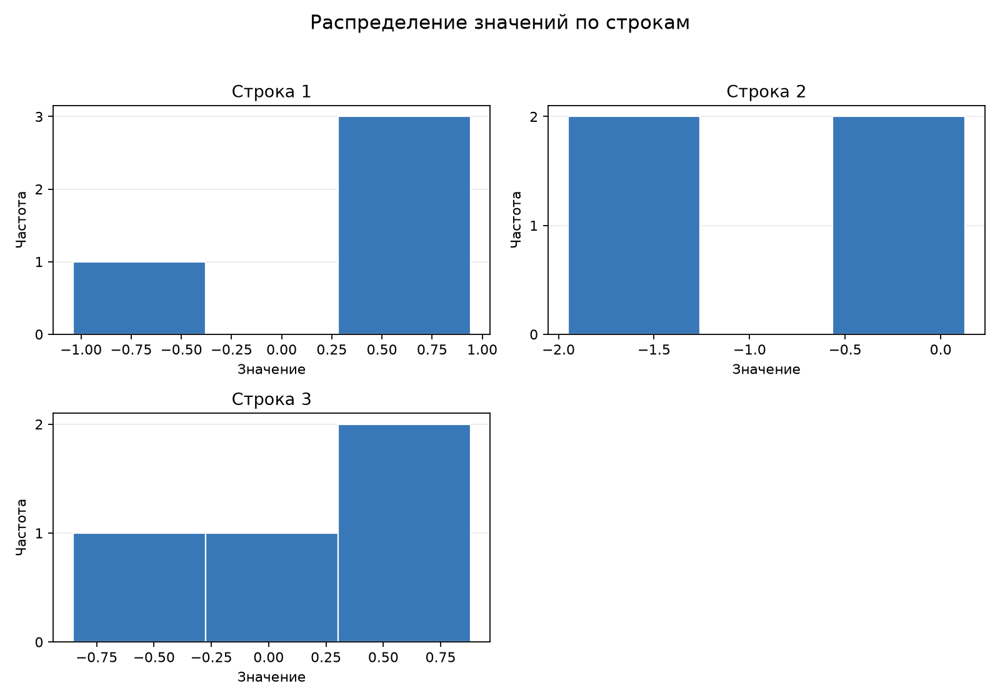
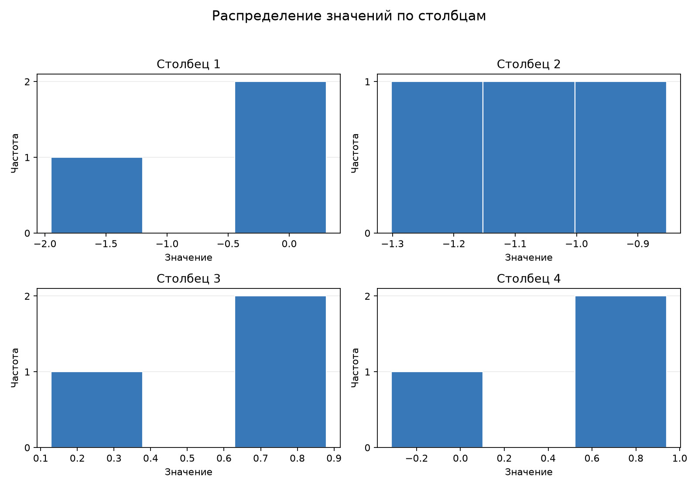

# Гистограммы случайной матрицы

Матрица размером 3 × 4 создана с `seed=42`, средним 0 и стандартным
отклонением 1. На отдельных графиках показано распределение значений каждой
строки и каждого столбца.

Для повторного построения выполните из корня репозитория:

```console
python plot_histograms.py
```

## Строки



## Столбцы


